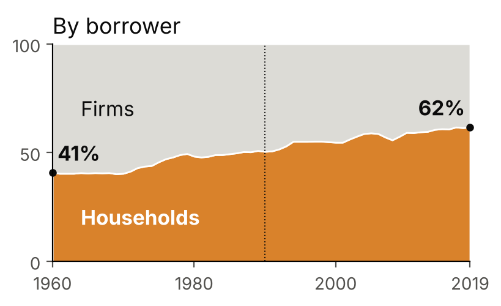
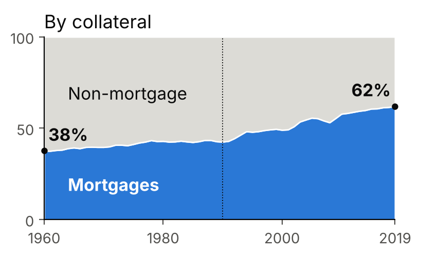

## Motivation: the Great Mortgaging

:::: {.columns}
::: {.column width="50%"}
{width="88%"}
:::
::: {.column width="50%"}
{width="88%"}
:::
::::

::: {.keybox}
Average of 11 countries, 1960–2019: firms **59% → 38%** of bank credit, mortgages **38% → 62%**. Over the century: mortgages about 30% around 1900, about 60% today. [JST data; Jordà, Schularick & Taylor 2016]{.src}
:::

::: {.warmbox}
**Question:** did this shift crowd out lending to **small, bank-dependent firms**, while large firms turned to bond markets?
:::

## A tension in the literature

:::: {.columns}
::: {.column width="50%"}
::: {.plainbox}
[US counties: Chakraborty et al. (2019)]{.boxtitle}

- 1988–2006, banks in strong housing markets
- **More** mortgages, **less** commercial lending
- Their borrowers invest less, especially constrained firms and banks
:::
:::
::: {.column width="50%"}
::: {.plainbox}
[Spain: Martín, Moral-Benito, Schmitz (2021)]{.boxtitle}

- Housing boom **first reduces** credit to non-housing firms
- **Later stimulates** it: the boom raises bank net worth
- Crowding-out large but **temporary**, absorbed by the end of the boom
:::
:::
::::

::: {.warmbox}
**So is crowding-out only a short-run effect?** The aggregate effect can fade while its *composition* does not: who loses credit, and do they come back?
:::

## My idea: firm size

:::: {.columns}
::: {.column width="54%"}
::: {.keybox}
[Bank with limited capital]{.boxtitle}

A euro of capital must earn the same in both uses:

$$R^f_t - R^d_t = \frac{\omega^f}{\omega^m}\,\big(R^m_t - R^d_t\big)$$

Mortgages pay more ⇒ the bank asks more from firms.
:::

[$R^f, R^m$: firm and mortgage rates; $R^d$: funding cost; $\omega^f, \omega^m$: capital charged per euro lent (Bâle I: 1 and 0.5).]{.note}
:::
::: {.column width="46%"}
::: {.plainbox}
[Short run (capital fixed)]{.boxtitle}

Firms pay a higher rate: small firms invest less or exit. Large firms escape through bonds.
:::

::: {.plainbox}
[Long run (capital adjusts)]{.boxtitle}

Crowding-out in levels fades (as in Spain), but firms stay structurally disadvantaged, and small firms that exited may not come back.
:::
:::
::::

## Usable data

| Source | What it gives | Coverage |
|---|---|---|
| County Business Patterns | Establishments and jobs by size class and sector | County, yearly |
| CRA | Small-business loans by bank and county | From 1996 |
| HMDA | Mortgage lending by bank | From the 1990s |
| FDIC Summary of Deposits | Where each bank has branches | From 1994 |
| Call Reports | Bank balance sheets, capital | Quarterly, long run |
| FHFA + Saiz (2010) | House prices + housing supply elasticity | County / metro |
| JST Macrohistory | Mortgage and non-mortgage credit, 17 countries | Since 1870 |

: {.datatable}

::: {.keybox}
All public, already collected.
:::

## Identification: the Saiz instrument

::: {.keybox}
[Push banks toward mortgages for reasons unrelated to local firms]{.boxtitle}

Housing booms in the *other* counties where a bank has branches, predicted by how hard it is to build there (Saiz 2010):

$$\text{Expo}_{c} = \sum_{\text{banks } b} \underbrace{s_{b,c}}_{\text{share in } c} \;\sum_{j\neq c} \underbrace{w_{b,j}\,\widehat{\Delta HPI}_{j}}_{\text{booms elsewhere}}$$
:::

:::: {.columns}
::: {.column width="50%"}
::: {.plainbox}
[Step 1: banks]{.boxtitle}

More mortgages, fewer small-business loans? Stronger when capital is low?
:::
:::
::: {.column width="50%"}
::: {.plainbox}
[Step 2: firms, 1 to 15 years]{.boxtitle}

Small vs large establishments in the same county. Does the gap close, as in Spain, or persist?
:::
:::
::::

# Backup {.backup}

## Backup: the bank's problem

$$\max_{L^m_t,L^f_t,S_t,D_t}\; R^m_t L^m_t + R^f_t L^f_t + R^s_t S_t - R^d_t D_t$$
$$\text{s.t.}\quad L^m_t + L^f_t + S_t = N_t + D_t,\qquad \omega^m L^m_t + \omega^f L^f_t \le \phi N_t$$

$$\frac{R^m_t - R^d_t}{\omega^m} = \lambda_t = \frac{R^f_t - R^d_t}{\omega^f}
\qquad\qquad dL^f_t = -\frac{\omega^m}{\omega^f}\,dL^m_t \quad (N_t \text{ fixed})$$

**Long run** ($N_t$ chosen, cost $R^e_t$):

$$\lambda_t = \frac{R^e_t - R^d_t}{\phi} \quad\Rightarrow\quad R^f_t = R^d_t + \frac{\omega^f}{\phi}\big(R^e_t - R^d_t\big)$$

The extended version adds default risk, collateral value (house prices) and information costs.

## Backup: step 2 regression

$$Y_{c,s,k,t+h} - Y_{c,s,k,t-1} = \beta_h\,\text{Expo}_{c,t}\times\text{Small}_k + \theta_h\,\Delta HPI_{c,t}\times\text{Small}_k + \delta_{c,t} + \mu_{s,k,t} + \varepsilon$$

- $c$ county, $s$ sector, $k$ size class, $h = 1,\dots,15$ years
- Prediction: $\beta_h < 0$; persistence tells short run from long run
- Local house prices control for the home-collateral channel (Adelino, Schoar & Severino 2013)
- Robustness: tradable sectors only (manufacturing)

## Backup: larger project

- **Bâle I (1988)**: mortgages charged half the capital of firm loans, a historical shock to $\omega^m/\omega^f$
- Back to the long-run trend across JST countries: land vs productive capital
- Model extension: rising cost of capital, or exit with entry costs, to make the effect persist
